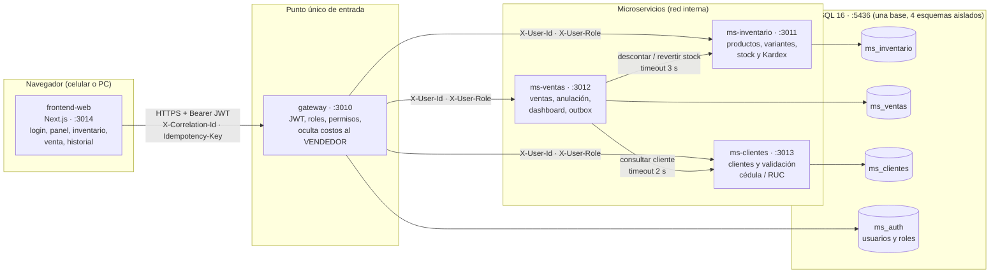
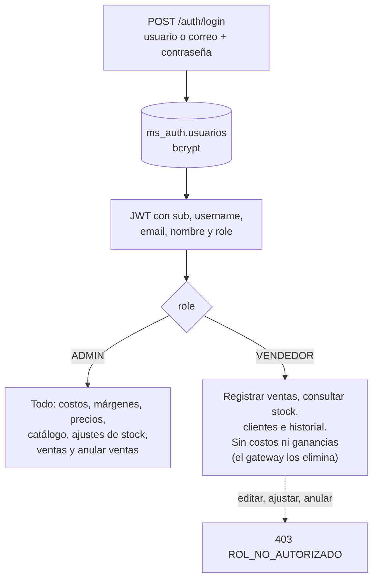
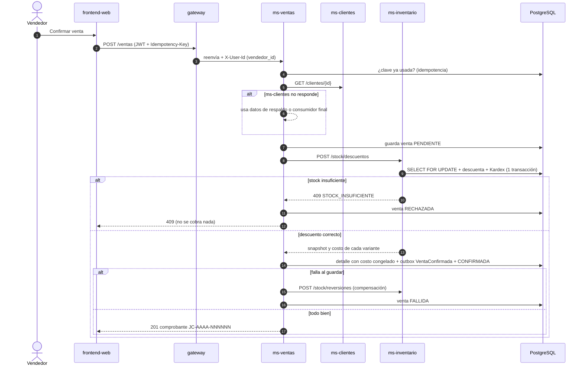
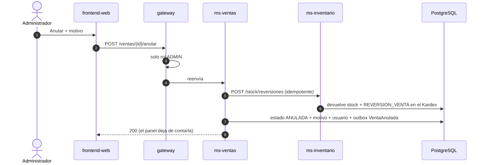
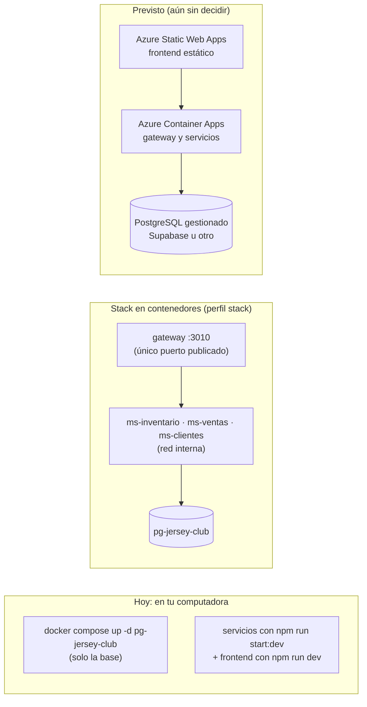

# Arquitectura actual — Sistema Jersey Club

Diagramas en Mermaid (se ven en la vista previa de VS Code con la extensión de Mermaid).

## 1. Vista general

El navegador solo habla con el gateway. Cada microservicio es dueño de su propio esquema en PostgreSQL y nunca consulta el de otro.

## 2. Quién puede hacer qué (roles)

## 3. Cierre de venta en 1 clic (saga orquestada por ms-ventas)

## 4. Anular una venta

## 5. Despliegue

