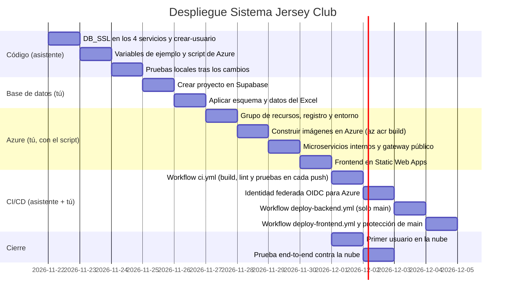

# Roadmap de despliegue — Sistema Jersey Club

Objetivo: publicar el sistema en la nube con **Supabase** (PostgreSQL), **Azure Container Apps** (gateway y microservicios) y **Azure Static Web Apps** (frontend). Cuenta de Azure para estudiantes.

## Estado actual

| Pieza | Estado |
|---|---|
| Código de los 4 servicios y el frontend | Listo y probado en local (backend 81/81, interfaz 21/21) |
| `Dockerfile` de cada servicio | Listo (multi-etapa, usuario sin privilegios, healthcheck) |
| `docker-compose.yml` con perfil `stack` | Listo y probado en local |
| SSL hacia la base (Supabase lo exige) | **Pendiente** (variable `DB_SSL`) |
| Variables de despliegue y script de Azure | **Pendiente** |
| Base en Supabase | **Pendiente** (proyecto por crear) |
| Recursos en Azure | **Pendiente** |
| Repositorio en GitHub | Hecho (último commit de la fase local en `origin/main`) |
| CI/CD con GitHub Actions | **Pendiente** (verificación en cada push y despliegue automático a Azure) |

## Responsables

- **Asistente (código):** cambios en el repositorio, scripts, documentación, pruebas automáticas y workflows de GitHub Actions.
- **Tú (cuentas y terminal):** creación de cuentas y recursos en Supabase y Azure, inicio de sesión (`az login`), y ejecución de comandos que requieren tu cuenta.

## Fases

### Fase 1 — Preparar el código (asistente)
- [ ] `DB_SSL=true` activa SSL en TypeORM de `ms-inventario`, `ms-ventas`, `ms-clientes` y `gateway`.
- [ ] `crear-usuario` usa SSL cuando `DB_SSL=true`.
- [ ] `deploy/variables.ejemplo.sh` con todas las variables (sin contraseñas).
- [ ] `deploy/desplegar.sh` con los comandos de Azure en orden, pensado para ejecutarse paso a paso.
- [ ] Pruebas automáticas y lint en verde.

### Fase 2 — Base de datos en Supabase (tú)
- [ ] Crear proyecto en Supabase y elegir región.
- [ ] Copiar la cadena de conexión (modo *Session pooler*).
- [ ] Aplicar `database/01_schema_mvp_jersey_club.sql` y `database/02_seed_inventario.sql`.
- [ ] Verificar: 4 esquemas y 54 productos / 95 variantes del Excel.

Nota: el plan gratuito de Supabase se pausa tras 7 días sin uso.

### Fase 3 — Azure: infraestructura (tú, con `deploy/desplegar.sh`)
- [ ] `az login` y proveedores `Microsoft.App` y `Microsoft.OperationalInsights` registrados.
- [ ] Grupo de recursos, registro de contenedores (ACR) y entorno de Container Apps.
- [ ] Imágenes construidas en Azure con `az acr build` (no hace falta Docker local).

### Fase 4 — Azure: servicios
- [ ] `ms-inventario`, `ms-ventas` y `ms-clientes` con ingreso **interno** (no accesibles desde internet).
- [ ] `gateway` con ingreso **externo**: único endpoint público.
- [ ] Secretos (`db-pass`, `jwt-secret`) cargados como secretos de la app, nunca en texto plano.
- [ ] `CORS_ORIGINS` con la URL final del frontend.

### Fase 5 — Frontend
- [ ] Static Web App (plan gratuito) creada.
- [ ] `NEXT_PUBLIC_API_URL` apuntando al gateway de la nube **antes** de compilar.
- [ ] Despliegue de `frontend-web/out` con el token de la Static Web App.

### Fase 4b — CI/CD con GitHub Actions

Objetivo: que cada cambio se verifique automáticamente al subirlo a GitHub, y que solo lo que pasa las pruebas llegue a Azure.

**Flujo propuesto**
1. Push o pull request → `ci.yml` compila, pasa el lint y las pruebas de los 5 proyectos (`ms-inventario`, `ms-ventas`, `ms-clientes`, `gateway`, `frontend-web`).
2. Merge a `main` → `deploy-backend.yml` construye las imágenes en Azure (`az acr build`), actualiza cada Container App a la nueva imagen y verifica `GET /api/v1/salud`.
3. Si la verificación falla, se revierte a la revisión anterior de la Container App.
4. Merge a `main` con cambios de frontend → `deploy-frontend.yml` compila con `NEXT_PUBLIC_API_URL` y publica en la Static Web App.

**Tareas**
- [ ] `ci.yml`: matriz por proyecto, `npm ci`, `npm run build`, `npm run lint` y pruebas. Falla el check si cualquier paso falla.
- [ ] Ajustar la prueba end-to-end para CI: hoy usa `docker exec pg-jersey-club`, que no existe en el runner. Opciones: un servicio PostgreSQL dentro del workflow, o dejarla solo para local.
- [ ] Identidad federada OIDC entre GitHub y Azure (sin contraseñas guardadas). Secretos del repositorio: `AZURE_CLIENT_ID`, `AZURE_TENANT_ID`, `AZURE_SUBSCRIPTION_ID`, `SWA_TOKEN`.
- [ ] Si la cuenta de estudiante no permite crear la identidad federada, usar un service principal con secreto de corta duración como plan B.
- [ ] `deploy-backend.yml`: solo en `main`, con entorno `production` (opcionalmente con aprobación manual).
- [ ] Verificación posterior al despliegue y rollback a la revisión anterior si falla.
- [ ] `deploy-frontend.yml` con `NEXT_PUBLIC_API_URL` como variable del repositorio.
- [ ] Protección de la rama `main`: no se puede hacer merge si `ci.yml` no está en verde.
- [ ] Los secretos de la base (`db-pass`, `jwt-secret`) viven como secretos de cada Container App; no se copian a GitHub.

### Fase 6 — Cierre
- [ ] Primer usuario ADMIN creado en la base de la nube.
- [ ] Inicio de sesión desde el frontend público.
- [ ] Venta de prueba y anulación, con reversión de stock verificada en la base de la nube.
- [ ] Datos de prueba eliminados.

## Riesgos y decisiones abiertas

| Tema | Riesgo | Mitigación |
|---|---|---|
| Créditos de estudiante | Consumo inesperado | `--min-replicas 0`; revisar el consumo cada semana |
| Arranque en frío | Primera petición de 5–10 s | Aceptable para el MVP; subir `min-replicas` si molesta |
| Pausa de Supabase | Base inaccesible tras 7 días sin uso | Reactivar desde el panel; considerar Neon como alternativa |
| Secretos | Filtración por el repositorio | `.env` y contraseñas fuera de git; solo `--secrets` |
| Servicios internos sin JWT | Acceso directo si se exponen | Solo el gateway tiene ingreso externo |
| Región | Restricciones de la cuenta estudiantil | Elegir una región permitida antes de crear recursos |
| Datos de producción | Pruebas que borran datos reales | El end-to-end solo en una base de pruebas, nunca en la de uso real |
| Minutos de GitHub Actions | Consumo agotado en repositorios privados | Verificar la visibilidad del repositorio y el límite del plan; cachear dependencias |
| Prueba end-to-end en CI | Depende de Docker local (`docker exec`) | Usar un servicio PostgreSQL en el workflow o dejarla solo en local |
| Despliegue automático roto | Una imagen nueva rompe producción | Verificación de salud y rollback a la revisión anterior |
| Permisos de la identidad federada | La cuenta estudiantil no permite crearla | Plan B con service principal de corta duración |

## Criterio de terminado

- Frontend público abre, permite iniciar sesión y muestra inventario real.
- Una venta y una anulación funcionan contra la base de Supabase.
- Los microservicios no responden desde internet (solo el gateway).
- Ningún secreto está en el repositorio.
